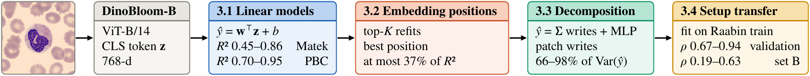
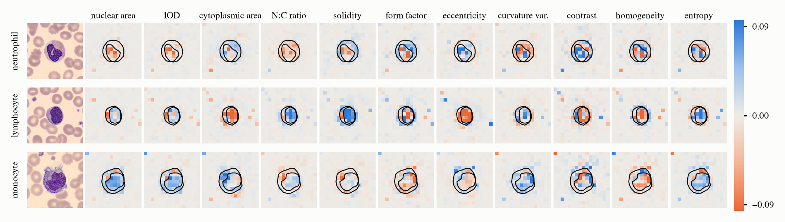
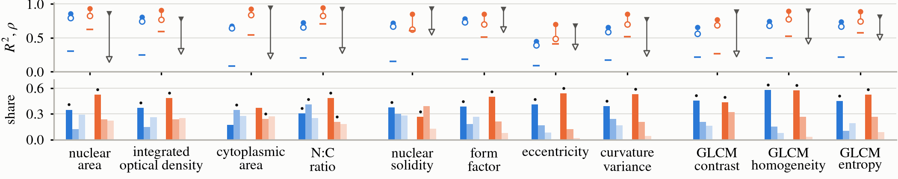
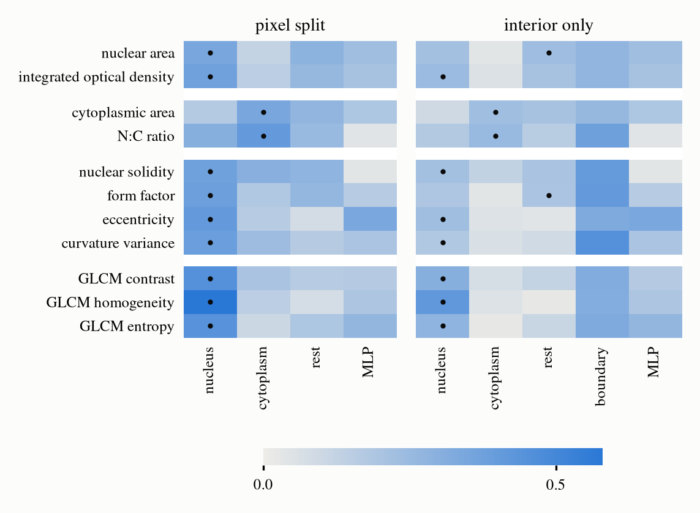

# Interpreting DinoBloom with Linear Models of Cytomorphometric Descriptors and an Exact Patch-Token Decomposition

Code, results and additional figures for the ISBI 2027 submission by Arjun Jeewan (Department of
Computer Science, Indian Institute of Technology Bombay) and Catherine Chia (Computational Pathology
Group, Radboud University Medical Center).

The paper measures eleven cytomorphometric descriptors per cell and fits one linear regression
model per descriptor on the embedding of DinoBloom-B's class token (CLS). It then tests whether
single embedding positions correspond to the descriptors, decomposes each prediction exactly into
the writes of individual tokens and the CLS token's MLP updates, and tests whether the models
transfer to another acquisition setup.



*Fig. 1. DinoBloom-B encodes each cell crop into the CLS embedding z. Boxes: method and main result
of Secs. 3.1–3.4, in the order of the analysis.*

## Contents

| Path | Contents |
|---|---|
| `src/acquire/` | downloads and indexes the datasets; the only code that uses the network |
| `src/` | splits, U-Net segmentation, morphometry, embeddings |
| `src/analysis/` | the analyses behind the paper's numbers |
| `src/figures.py`, `figures/overview/` | figure code |
| `results/` | the summaries the paper's numbers are read from |
| `figures/`, `tables/` | the paper's figures (PDF, with PNG copies for this page), Table 1, and the additional figures below |
| `data/pretraining_status.csv` | which datasets and splits DinoBloom saw in pretraining |

## Setup

Python 3.11 with the versions pinned in `requirements.txt` (torch 2.6.0, CUDA 12.6):

```bash
conda create -n dinobloom-linear python=3.11
conda activate dinobloom-linear
pip install -r requirements.txt
```

The figures use the Nimbus Roman font (`fonts-urw-base35` on Debian and Ubuntu). The pipeline
figure is rendered with Inkscape.

## Data and weights

| | Source | License |
|---|---|---|
| Matek bone marrow | TCIA, [doi:10.7937/TCIA.AXH3-T579](https://doi.org/10.7937/TCIA.AXH3-T579), read from a HuggingFace mirror audited against the TCIA original | CC BY 4.0 |
| PBC | Mendeley Data, [doi:10.17632/snkd93bnjr.1](https://doi.org/10.17632/snkd93bnjr.1) | CC BY 4.0 |
| Raabin-WBC | [raabindata.com](https://raabindata.com) | "freely available for all" (dataset paper); no license stated |
| DinoBloom-B weights | [`1aurent/vit_base_patch14_224.dinobloom`](https://huggingface.co/1aurent/vit_base_patch14_224.dinobloom), a timm port of the [official release](https://zenodo.org/records/10908163) | Apache 2.0 |

```bash
python -m src.acquire.matek_bm
python -m src.acquire.raabin
python -m src.acquire.pbc
python -m src.acquire.pretraining_status        # -> data/pretraining_status.csv
hf download 1aurent/vit_base_patch14_224.dinobloom --local-dir data/weights/timm_vit_base_patch14_224.dinobloom
```

Everything after this step runs offline.

## Reproducing the paper

Run from the repository root, in this order. `--read-test` scores the PBC test split and Raabin
test set B once; the scripts refuse it while `src/` has uncommitted changes.

```bash
# Labels: a U-Net per seed (25 seeds, film-disjoint splits), then the 11 descriptors for every cell
python -m src.splits
python -m src.masks
python -m src.segment --mode film --seeds $(seq 0 24)
for s in $(seq 0 24); do python -m src.propagate --seed $s; done
python -m src.morphometry

# DinoBloom-B CLS embeddings
python -m src.embed --encoder dinobloom --dataset matek_bm pbc raabin

# Matek (Secs. 3.1-3.3)
python -m src.analysis.linear_cv
python -m src.analysis.linear_cv_dims
python -m src.analysis.linear_cv_weights
python -m src.analysis.linear_cv_ablation
python -m src.analysis.linear_cv_within
python -m src.analysis.linear_cv_raabin
python -m src.analysis.linear_cv_gradcam
python -m src.analysis.linear_cv_attribution
python -m src.analysis.linear_cv_attnpath

# PBC and Raabin (Secs. 3.1, 3.3, 3.4)
python -m src.analysis.linear_unseen --dataset pbc --read-test
python -m src.analysis.linear_unseen --dataset raabin --read-test
python -m src.analysis.linear_unseen_ablation --read-test
python -m src.analysis.linear_unseen_attnpath --read-test

# Region leads under a bootstrap over cells (Sec. 3.3; post hoc, from the stored per-cell terms)
python -m src.analysis.linear_region_lead

# Table 1 and figures
python -m src.analysis.linear_cv_table
python -m src.figures --only maps_all          # Fig. 2
python -m src.figures --only summary           # additional result 1
python -m src.figures --only attnpath          # additional result 4
python figures/overview/make_overview.py       # Fig. 1
inkscape figures/overview/overview.svg --export-type=pdf --export-filename=figures/overview.pdf
```

Comments and result files mention `protocol.md`, the written analysis plan of the working
repository; its section 16 fixed the PBC and Raabin benchmark before any test cell was read. It
is not part of this repository. The bootstrap of the region leads was added after the test split
was read and is labeled post hoc in the paper.

## Table 1 and Fig. 2

Table 1. Scores of the linear models: Matek, mean of 5 validation folds; PBC test split and Raabin
set B, scored once, mean of the five fits. Within: R² within cell type. Last rows: cell-type
classifier (21, 7, 5 classes). Largest sd: 0.010 (Matek), 0.005 (PBC), 0.042 (Raabin ρ), 0.124
(Raabin R²). Raabin R² is scored only for the scale-invariant descriptors.

| Linear regression | Matek R² (val) | within | PBC R² (test) | within | Raabin ρ (set B) | Raabin R² (set B) |
|---|---:|---:|---:|---:|---:|---:|
| nuclear area | 0.857 | 0.795 | 0.935 | 0.827 | 0.186 | – |
| integrated optical density | 0.806 | 0.742 | 0.906 | 0.768 | 0.302 | – |
| cytoplasmic area | 0.676 | 0.646 | 0.926 | 0.839 | 0.235 | – |
| N:C ratio | 0.727 | 0.658 | 0.949 | 0.827 | 0.315 | −0.079 |
| nuclear solidity | 0.722 | 0.672 | 0.853 | 0.626 | 0.588 | 0.220 |
| form factor | 0.781 | 0.731 | 0.854 | 0.703 | 0.625 | – |
| eccentricity | 0.448 | 0.394 | 0.700 | 0.489 | 0.369 | −0.260 |
| curvature variance | 0.657 | 0.587 | 0.854 | 0.699 | 0.270 | – |
| GLCM contrast | 0.656 | 0.561 | 0.770 | 0.685 | 0.265 | – |
| GLCM homogeneity | 0.746 | 0.681 | 0.894 | 0.776 | 0.454 | – |
| GLCM entropy | 0.741 | 0.670 | 0.891 | 0.743 | 0.509 | – |
| cell type, accuracy | 0.847 | – | 0.983 | – | 0.928 | – |
| cell type, balanced accuracy | 0.632 | – | 0.985 | – | 0.949 | – |



*Fig. 2. Patch-token writes on PBC test cells: one neutrophil, lymphocyte and monocyte (rows), drawn
at random before any map was viewed, for the 11 linear models (columns; IOD: integrated optical
density; contrast, homogeneity and entropy are GLCM features). Left: the 224 px input. Each map
shows, per patch, the write summed over the 12 blocks and averaged over the five fits, minus its
mean over the 2,211 test cells, in units of the prediction's sd; one color scale. Lines: nucleus and
cell outlines (U-Net). Top-left patch: a high-norm token.*

## Where each number comes from

All files are in `results/`.

| Paper | File |
|---|---|
| Sec. 2, U-Net Dice | `segmentation_dice_film.json` (seeds 0-2), `segmentation_dice_film_seeds3to24.json` |
| Sec. 2, label reliability; Table 1, Matek | `linear_cv_dinobloom_matek_bm.json`, `linear_cv_within_dinobloom_matek_bm.json` |
| Table 1, PBC and Raabin; label reliability | `linear_unseen_dinobloom_pbc.json`, `linear_unseen_dinobloom_raabin.json` |
| Sec. 3.1, cell type alone, within cell type, validation against test | `linear_cv_within_dinobloom_matek_bm.json`, `linear_unseen_dinobloom_pbc.json` and `.parquet` |
| Sec. 3.2, subsets of embedding positions | `linear_cv_ablation_dinobloom_matek_bm.json`, `linear_unseen_ablation_dinobloom_pbc_test.json` |
| Sec. 3.2, free direction | `linear_cv_weights_dinobloom_matek_bm.json` |
| Sec. 3.2, positions on Raabin | `linear_cv_raabin_dinobloom.json` |
| Sec. 3.3, saliency maps | `linear_cv_attribution_dinobloom_matek_bm.json` and `.parquet` |
| Sec. 3.3, decomposition and region leads | `linear_cv_attnpath_dinobloom_matek_bm.json`, `linear_unseen_attnpath_dinobloom_pbc.json` |
| Sec. 3.3, bootstrap of the region leads | `linear_region_lead_dinobloom.json` |
| Sec. 3.4 | `linear_unseen_dinobloom_raabin.json` |

## Additional results

### 1. Per-descriptor summary



Per descriptor (columns; `figures/linear_summary_dinobloom.pdf`). **Top:** R² on Matek validation
(blue) and PBC test (orange), filled; R² within cell type, open; R² of cell type alone, dashes;
Spearman ρ on Raabin validation (filled) and set B (open triangles). **Bottom:** shares of the
prediction's variance carried by the patch-token writes from nucleus, cytoplasm and the rest of
the crop (dark to light), Matek (blue) and PBC test (orange); dots mark the measured regions.
Means over five folds or fits (largest sd 0.042).

### 2. The LayerNorm free direction (Sec. 3.2)

The embedding leaves a LayerNorm, z = γ ⊙ (h − h̄1)/σ + β, so every embedding satisfies
Σⱼ (zⱼ − βⱼ)/γⱼ = 0. The covariance of the embeddings is therefore singular along γ⁻¹, and a
coefficient vector w is identified only up to w + tγ⁻¹: adding any multiple of γ⁻¹ to w changes no
prediction. In `results/linear_cv_weights_dinobloom_matek_bm.json`:

- `null_direction`: in every fold, the null direction of the covariance is γ⁻¹
  (`abs_cos_with_inverse_ln_scale` = 1.0000), and 98.76% of its squared norm lies on embedding
  position 38 (`share_on_dropped`).
- `ln_scale_summary`: position 38 has the smallest scale in the layer, γ₃₈ = −0.00712
  (`ln_scale_at_dropped`), against a median |γ| of 1.707.

Moving w along γ⁻¹ changes mainly the coefficient of position 38 and leaves every prediction
unchanged, so single coefficients are not identifiable.

### 3. Saliency maps against occlusion (Sec. 3.3)

- **Cells:** 60 Matek evaluation cells, 10 per granulocytic stage (myeloblast, promyelocyte,
  myelocyte, metamyelocyte, band and segmented neutrophil).
- **Maps**, per cell and linear model:
  - signed Grad-CAM and gradient × activation on the patch tokens leaving each block's first
    LayerNorm, at each of the 12 blocks;
  - occlusion of each 14 × 14 patch by two fills: gray (0 after normalization) and the crop's
    background (the per-channel median of its border ring).
- **Score:** Pearson r between a map and the occlusion map, median over the 60 cells and the 11
  linear models. These are the rows of `results/linear_cv_attribution_dinobloom_matek_bm.parquet`
  with `kind == "readout"` and `set == "evaluation"`; blocks are 0-indexed there.

| Block | Grad-CAM, background fill | Grad-CAM, gray fill | Gradient × activation, background fill | Gradient × activation, gray fill |
|---:|---:|---:|---:|---:|
| 1 | −0.025 | −0.025 | −0.086 | −0.059 |
| 2 | 0.025 | −0.026 | −0.014 | −0.008 |
| 3 | −0.017 | −0.006 | −0.046 | −0.027 |
| 4 | −0.006 | −0.001 | 0.085 | 0.043 |
| 5 | 0.022 | 0.010 | 0.121 | 0.072 |
| 6 | 0.095 | 0.057 | 0.159 | 0.101 |
| 7 | 0.027 | 0.051 | 0.080 | 0.067 |
| 8 | 0.038 | 0.041 | 0.088 | 0.074 |
| 9 | 0.071 | 0.015 | 0.062 | 0.046 |
| 10 | 0.091 | 0.036 | 0.061 | 0.028 |
| 11 | 0.079 | 0.043 | 0.065 | 0.049 |
| 12 | 0.095 | 0.018 | 0.169 | 0.111 |

The occlusion maps with the two fills correlate at a median r of 0.480.

### 4. Region shares and their bootstrap (Sec. 3.3)

Linear models for which the region where the descriptor is measured carries the largest share of
the prediction's variance. For the N:C ratio, nucleus and cytoplasm must both exceed the rest of
the crop.

| | Pixel split | Interior patches only |
|---|---:|---:|
| Matek, all cells | 11 of 11 | 9 of 11 |
| Matek, within cell type | 9 of 11 | 7 of 11 |
| PBC test split, all cells | 9 of 11 | 1 of 11 |
| PBC test split, within cell type | 10 of 11 | 0 of 11 |

Seven linear models lead in all four Matek settings: cytoplasmic area, eccentricity, curvature
variance, GLCM contrast, homogeneity and entropy, and integrated optical density. On PBC the
nucleus covers 5.5% of the crop and 0.26% of the patches lie wholly inside a nucleus, so the
interior-only split is uninformative there.

Bootstrap over cells (pixel split, all cells; 10,000 resamples, seed 0;
`results/linear_region_lead_dinobloom.json`). Margin: the measured region's share minus the
largest other region's share (N:C: the smaller of nucleus and cytoplasm minus the rest); negative
when another region leads. Cells are resampled as independent units, although several come from
the same patient and film, so the intervals are a lower bound on the uncertainty.

| Linear model | Matek: measured region leads | margin (95% interval) | PBC test: measured region leads | margin (95% interval) |
|---|---:|---:|---:|---:|
| nuclear area | 100.00% of resamples | 0.057 (0.032 to 0.082) | 100.00% of resamples | 0.288 (0.269 to 0.305) |
| integrated optical density | 100.00% of resamples | 0.111 (0.081 to 0.141) | 100.00% of resamples | 0.228 (0.192 to 0.258) |
| cytoplasmic area | 100.00% of resamples | 0.071 (0.044 to 0.098) | 0.00% of resamples | −0.133 (−0.154 to −0.112) |
| N:C ratio | 100.00% of resamples | 0.056 (0.030 to 0.083) | 99.95% of resamples | 0.022 (0.009 to 0.036) |
| nuclear solidity | 100.00% of resamples | 0.071 (0.052 to 0.090) | 0.00% of resamples | −0.123 (−0.137 to −0.109) |
| form factor | 100.00% of resamples | 0.117 (0.097 to 0.137) | 100.00% of resamples | 0.291 (0.270 to 0.311) |
| eccentricity | 100.00% of resamples | 0.244 (0.226 to 0.262) | 100.00% of resamples | 0.419 (0.406 to 0.432) |
| curvature variance | 100.00% of resamples | 0.149 (0.128 to 0.169) | 100.00% of resamples | 0.323 (0.302 to 0.344) |
| GLCM contrast | 100.00% of resamples | 0.251 (0.231 to 0.273) | 100.00% of resamples | 0.113 (0.091 to 0.135) |
| GLCM homogeneity | 100.00% of resamples | 0.430 (0.409 to 0.451) | 100.00% of resamples | 0.308 (0.285 to 0.330) |
| GLCM entropy | 100.00% of resamples | 0.258 (0.226 to 0.289) | 100.00% of resamples | 0.259 (0.238 to 0.280) |

`figures/linear_cv_attnpath_dinobloom.pdf` (all cells, below) and
`figures/linear_cv_attnpath_within_dinobloom.pdf` (within cell type) show the Matek shares:



- **Color:** the share of each prediction's variance, on 2,000 cross-validation cells.
- **Rows:** linear models. **Columns:** patch-token writes by region, and the CLS token's MLP updates.
- **Left panel:** boundary patches split by pixel fraction. **Right panel:** interior patches
  only, with boundary patches as one column.
- **Dot:** the largest region in each row.
- **Not shown:** the CLS token's write to itself and the constant terms.

## License

Code: MIT (`LICENSE`). The datasets and weights keep their own licenses (table above).
